<!-- ============================================================
     Akash Nigam - GitHub profile README
     Repo name must be exactly: akash59nigam-a11y
     Items marked "VERIFY" / "TODO" need your confirmation
     ============================================================ -->

<!-- HEADER -->

  

<!-- TYPING ANIMATION -->
<h1 align="center">
  
</h1>

<!-- FOCUS BADGES: AI = primary, Cloud = secondary -->

  
  

 

<!-- ABOUT -->
<table width="100%">
  <tr>
    <td width="60%" valign="top">

## 🚀 About Me

**🎓 Education** 
BCA · KCNIT College of Education, Bundelkhand University · `2024 – 2027`

**🧠 Focus**
- **Primary:** AI / ML, data analysis and model building with Python, Pandas, NumPy and Scikit-learn
- **Secondary:** Cloud computing on AWS

**💼 Experience**
- 📊 **Data Science Intern**, SkillCraft Technology
<!--
VERIFY BEFORE UNCOMMENTING (SETUP.md section 6). Delete any line you cannot back with a certificate or offer letter:
- 📈 **Data Analyst Intern**, Unfield
- ☁️ **AWS Cloud Computing Intern**, (add company name)
- 🤖 **Back-End AI Engineering Intern**, FlyRank AI
-->

**🏆 Highlights**
- 🎓 **College Ambassador ×2** (incl. GeeksforGeeks Campus Mantri, IIT bombay ) <!-- VERIFY: name both programs -->
- 🎯 **TCS iON Career Edge**
- 📜 **Internship & AWS certificates**

</td>
      <td width="40%" valign="middle" align="center">
      
    </td>
  </tr>
</table>

<!-- TECHNOLOGY ARSENAL -->
<h2 align="center">🔧 Technology Arsenal</h2>

<!-- FEATURED PROJECTS -->
<h2 align="center">📌 Featured Projects</h2>

  <table>
    <tr>
      <td width="50%" valign="top" align="center">
        <h3><a href="https://github.com/akash59nigam-a11y/bank-marketing-ml-classifier">bank-marketing-ml-classifier</a></h3>
        <!-- VERIFY: repo URL not checked (could not reach GitHub) -->
        
Machine-learning classifier on the Bank Marketing dataset.

        

          
          
          
        

      </td>
      <td width="50%" valign="top" align="center">
        <h3><a href="https://github.com/akash59nigam-a11y/interactive-world-population-dashboard">interactive-world-population-dashboard</a></h3>
        <!-- VERIFY: repo URL not checked (could not reach GitHub) -->
        
Interactive dashboard exploring world population data.

        

          
          
        

      </td>
    </tr>
    <tr>
      <td width="50%" valign="top" align="center">
        <h3><a href="https://github.com/akash59nigam-a11y?tab=repositories">HR Attrition Analysis</a></h3>
        <!-- TODO: replace link with exact repo URL (slug unknown) -->
        
Analysis of employee attrition patterns and drivers.

        

          
          
        

      </td>
      <td width="50%" valign="top" align="center">
        <h3><a href="https://github.com/akash59nigam-a11y?tab=repositories">Nassau Candy: Factory Reallocation &amp; Shipping Optimization</a></h3>
        <!-- TODO: replace link with exact repo URL (slug unknown) -->
        
Factory reallocation and shipping optimization analysis.

        

          
          
        

      </td>
    </tr>
    <tr>
      <td width="50%" valign="top" align="center">
        <h3><a href="https://github.com/akash59nigam-a11y?tab=repositories">Palo Alto Promotion Gap Analysis</a></h3>
        <!-- TODO: replace link with exact repo URL (slug unknown) -->
        
Promotion gap analysis.

        

          
          
        

      </td>
      <td width="50%" valign="middle" align="center">
        <h3><a href="https://github.com/akash59nigam-a11y?tab=repositories">More on GitHub →</a></h3>
        
All repositories, including work in progress.

      </td>
    </tr>
  </table>

 

<!-- GITHUB STATS -->
<h2 align="center">🔥 Digital Footprint</h2>

  

 

<!-- CONTRIBUTION GRAPH -->

  

 

<!-- CONNECT -->
<h2 align="center">📫 Connect With Me</h2>

  
  

 

